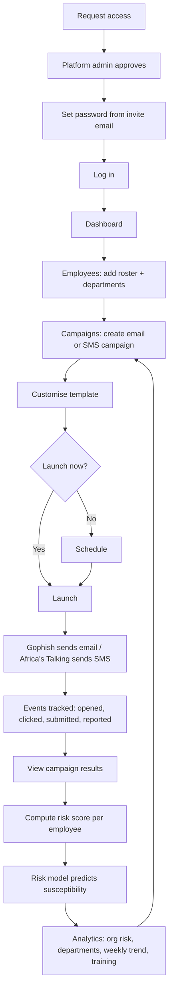
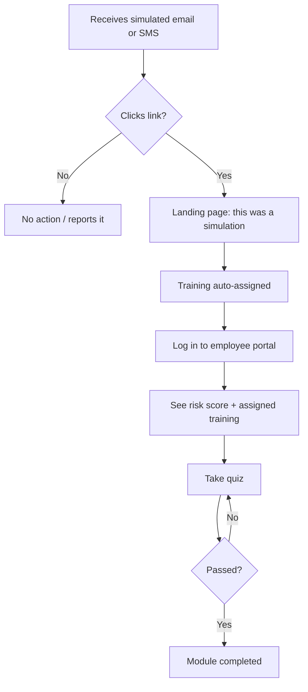

# RedFlag

Simulates phishing/smishing attacks and predicts employee susceptibility with
logistic regression for Kenyan organizations.

## Stack

- Simulation engine: Node/Express, JWT + bcrypt auth, RBAC
- Portal: React — admin + employee portals
- DB: PostgreSQL, 3NF, multi-tenant
- Risk model: Python/scikit-learn logistic regression scoring service
- Integrations: Gophish (email), Africa's Talking (SMS)

## Layout

```
/simulation-engine   Express API (auth, campaigns, scoring, training, analytics)
/portal              React admin + employee portals
/risk-model          Python logistic regression scorer
```

## Flows

### Admin



### Employee



## Run locally

1. `cp .env.example .env` and fill in secrets (see below).
2. `docker compose up --build`
3. Migrations run automatically on engine start (`npm run migrate` to run by hand).
4. Seed a demo org: `docker compose exec simulation-engine npm run seed:demo`
   (admin `admin@demo.redflag` / `Demo1234!`).

Ports: Postgres `5432`, simulation-engine `4000`, risk-model `8000`, portal
`5173`, Gophish `3333`/`8080`.

Run a service on its own: `npm run dev` (simulation-engine/portal) or
`uvicorn app.api:app --reload` (risk-model, Python 3.11, after
`pip install -r requirements-dev.txt`).

### Secrets (`.env`, never committed)
- `JWT_SECRET` — strong random value (the engine refuses the placeholder in production).
- `GOPHISH_API_KEY` — from the Gophish admin UI (Settings). `GOPHISH_WEBHOOK_SECRET` — any random value, shared with the webhook.
- `GMAIL_USER` / `GMAIL_APP_PASSWORD` — a dedicated Gmail + 16-char App Password (not the login password) for sending simulated email.
- `AT_API_KEY` — Africa's Talking sandbox key.
- `GOOGLE_CLIENT_ID` — Google OAuth web client ID (origin `http://localhost:5173`). Blank hides the Google button.
- `PORTAL_URL` — portal address for reset/invite links (default `http://localhost:5173`).
- `WEBAUTHN_RP_ID` / `WEBAUTHN_ORIGIN` — passkey host and origin (default `localhost` / `PORTAL_URL`).

### Login
- Password or Google, then a 6-digit email code. Passkeys (added in Settings) skip the code.
- Only accounts an admin has added can log in; others land on `/not-approved`.
- Sessions last 20 minutes.
- Forgot password: emailed reset link (30 min).

### Roles
- No self sign-up: orgs request access at `/request-access`; a system admin approves (org created, admin invited) or declines.
- System admin: reviews requests, onboards/suspends orgs, platform analytics, global templates. `npm run create:system-admin -- <email> "<Name>"` (demo seed: `system@demo.redflag` / `Demo1234!`).
- Org admin: employees, campaigns, templates, training.
- Employee: training, quizzes, reports.

### Email setup (Gophish)
`docker compose exec simulation-engine npm run gophish:setup` provisions the
SMTP profile, a safe awareness landing page (captures nothing), and the events
webhook.

## Tests
- Engine: `npm test` (Jest/Supertest).
- Risk model: `cd risk-model && pytest` (needs `requirements-dev.txt`).

## ML model
- `cd risk-model && python -m ml.train` — generates synthetic data, trains,
  evaluates, and writes an evidence run to `ml/ runs/<id>/` (metrics, plots,
  held-out predictions, git commit, data/model checksums).
- Docker trains on first start if `models/latest.joblib` is missing.
- **Synthetic data only.** Reported metrics describe the model on synthetic
  data, never real-world effectiveness. Held-out AUC-ROC is ~0.71 (below the
  0.85 target) with the honest, non-circular label — see `docs/chapter5/`.

## Sprint II docs
`docs/sprint2/` (board, test log, design deltas, demo script, deployment,
AI log), `docs/TRACEABILITY.md`, `docs/chapter5/`, `docs/decisions/`.

## Contributing

See [CONTRIBUTING.md](CONTRIBUTING.md).

## Status

- Auth, org registration, employee roster
- Email (Gophish) and SMS (Africa's Talking) campaigns, scheduling, template customisation
- Susceptibility scoring, adaptive training with quizzes, analytics dashboard

## Known constraints

- Africa's Talking sandbox: no custom sender ID; messages go to the simulator only
- Gophish needs a reachable listener (public HTTPS in production) for tracking links and webhooks
- ML metrics are from synthetic data; a real pilot is future work (issue #6)
- Migrations: `simulation-engine/src/db/migrations/*.sql`, applied on start or `npm run migrate`
